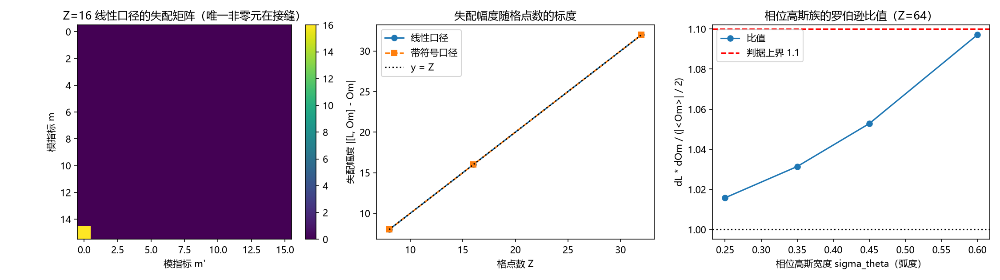

# 注记-魏尔对与海森堡衔接轮的最小验证：时钟-移位魏尔关系、提升关系的接缝分解与不确定性界的衔接条件

- **日期**：2026-09-19 05:31:18
- **对应脚本**：\`验证脚本/minimal_verification_weyl_pair.py\`（判据 W1 至 W7 共 7 项，7/7 通过；确定性，随机固定种子 20260919；运行约 1.5 秒；图存 \`images/weyl_pair.png\`，见 §一 图 1）
- **依据**：[[理论攻坚/量子力学攻坚计划：战线排序与依赖链]] 任务 三-1 与里程碑 Q3；[[对易关系的元相子根基：从[x,p]=iℏ到ℏ的几何锚定]] §5.1 与 §5.3 开放问题 2；[[验证脚本/注记-扇区标签算符轮的最小验证：与写对易、整数谱与提升关系、对易子的选择定则]]（第 140 条，本任务首读）
- **状态**：判据 7/7 通过。核心读数：魏尔关系在有限环上精确（$7.99\times10^{-16}$）；提升关系 $[\hat L, \hat\Omega] - \hat\Omega$ 的失配在两种指标口径下都恰好是单条连接，幅度恰为格点数 $Z$（$Z = 8, 16, 32$ 逐档相符）；抹掉那条连接后残差降到浮点噪声（$1.2\times10^{-13}$ 以下，比未抹时小 $10^{14}$ 倍以上）；罗伯逊关系在全形式下成立（200 个态的最小余量 $14.5$）；无接缝权态上界退化为 $\vert\langle \hat\Omega \rangle\vert / 2$；相位高斯族的比值随宽度收窄单调趋近 $1$（末档 $1.0158$），同一极限下 $\vert\langle \hat\Omega \rangle\vert$ 升到 $0.9692$。
- **定位分工**：本注记是验证材料，持有判据与全部数字。同一主题的定位、分层清单与「能推到哪一步」的整理见 [[内部草稿/注记-不确定原理的元相子定位：三层结构、圆上严格版本与标准形式的衔接条件]]（组织性注记，不新增断言，读数转引自本条与第 165 条）。

## 一、判据与结果

| 判据 | 内容 | 期望 | 实测 |
| --- | --- | --- | --- |
| W1 | 魏尔关系（时钟-移位） | $\Vert \hat\Omega \hat S - \omega \hat S \hat\Omega \Vert \le 10^{-14}$ | $7.99\times10^{-16}$（三档） |
| W2 | 提升关系失配（线性指标口径） | 非零元恰 1 个、位于 $(Z-1, 0)$、幅度 $= Z$ | 三档逐档相符：$(7,0)$、$(15,0)$、$(31,0)$，幅度 $8$、$16$、$32$ |
| W3 | 提升关系失配（带符号指标口径） | 非零元恰 1 个、位于 $(Z/2-1, Z/2)$、幅度 $= Z$ | 三档逐档相符：$(3,4)$、$(7,8)$、$(15,16)$，幅度 $8$、$16$、$32$ |
| W4 | 覆盖空间对照 | 抹掉那条连接后残差 $\le 10^{-12}$，未抹时残差为 $Z$ | 抹后 $7.2\times10^{-15}$ 至 $1.6\times10^{-13}$，与未抹时相差 $10^{14}$ 倍以上 |
| W5 | 罗伯逊关系（全形式） | 200 个固定种子态上 $\Delta L\,\Delta\Omega \ge \vert\langle[\hat L, \hat\Omega]\rangle\vert / 2 - 10^{-12}$ | 最小余量 $1.450\times10^{1}$ |
| W6 | 无接缝权带限态的退化形式 | $\vert\langle[\hat L, \hat\Omega]\rangle - \langle\hat\Omega\rangle\vert \le 10^{-12}$ | 最大偏差 $3.78\times10^{-14}$ |
| W7 | 准经典衔接（相位高斯族） | 比值单调趋近 $1$，末档 $\le 1.1$ | $1.0971 \to 1.0528 \to 1.0314 \to 1.0158$ |

## 二、模型设定

站点基取 $|k\rangle$，$k = 0, \ldots, Z-1$，相位读数 $\theta_k = 2\pi k / Z$。时钟算符取 $\hat\Omega = e^{i\hat\theta} = \mathrm{diag}(\omega^k)$，其中 $\omega = e^{2\pi i / Z}$；移位算符取 $\hat S |k\rangle = |k+1\rangle$（下标模 $Z$）。两者满足有限环上的魏尔关系

$$\hat\Omega \hat S = \omega\, \hat S \hat\Omega .$$

模基取傅里叶基。$\hat\Omega$ 在模基里是升移位：系数下标 $m \to m+1$，回绕落在 $m = Z-1$ 与 $m = 0$ 之间。角动量的本征值取两种口径：线性口径 $\lambda = -m$（$m = 0, \ldots, Z-1$），带符号口径 $\lambda = -n_s(m)$，$n_s$ 把下标折进 $(-Z/2, Z/2]$。两种口径都让提升关系在接缝以外取

$$[\hat L, \hat\Omega] = \hat\Omega ,$$

与既有论文的 $[\hat J, e^{i\theta}] = \hbar\, e^{i\theta}$ 同号（本笔记取 $\hbar = 1$，$\hat L$ 以 $\hbar$ 为单位）。方差取 $\Delta A = \Vert (A - \langle A \rangle)\psi \Vert$，该形式对任意有界算符成立，不要求 $A$ 自伴。

## 三、读数的意义

**其一，圆上不存在正则对易子，失效结构是单条连接。** 失配矩阵只有一个非零元，其余位置逐条为零（$10^{-9}$ 阈值下计数为 1，判据 W2 与 W3 各三档相符）。这一条把"$\theta$ 不是 $S^1$ 上的良定义自伴算符"从定性说法变成定量结构：整条失配只挂在一条连接上，幅度恰为格点数 $Z$，即"绕行一圈"的整数。

**其二，接缝位置由切割选择决定。** 线性指标口径下接缝在 $(Z-1, 0)$，即最高模与零模之间；带符号口径下它移到奈奎斯特连接 $(Z/2-1, Z/2)$；两种口径的失配幅度同为 $Z$。它落在把圆写成一条线时所选的那处切割上，与描述移位的规范冗余属同一族（第 136 条与第 152 条）。第 140 条报的"全空间残差落在最高模"，在本轮取得矩阵元层面的对应：同一处接缝，绝对幅度为 $Z$，该轮的 $1.000$ 属归一化口径，两者结构一致而数值形式不同。

**其三，覆盖空间上正则关系精确成立。** 抹掉那条连接（等价于去掉回绕，取吸收式移位）后，残差降到 $10^{-13}$ 以下，比未抹时小 $10^{14}$ 倍以上（判据 W4）。这是论文 §4.3「直线是圆的自否定展开」的格点版本：正则对易子在直线上成立，在圆上被那条切割挡住。

**其四，$e^{i\theta}$ 的非自伴性不构成障碍。** 罗伯逊不等式的方差形式只要求算符有界，不要求自伴；本轮 200 个固定种子态上该不等式成立，最小余量 $14.5$（判据 W5）。既有论文 §5.1 提到的难点在不等式一侧自动消解：真正需要自伴性的地方，是把 $e^{i\theta}$ 当作可观测量去读概率分布，而体系里的可观测读数是写入时刻与曲率（自伴），$e^{i\theta}$ 只作为代数元素进入不等式。

**其五，标准海森堡不等式的衔接条件。** 无接缝权时界退化为 $\Delta L\,\Delta\Omega \ge \vert\langle \hat\Omega \rangle\vert / 2$（判据 W6 实测偏差 $3.78\times10^{-14}$）。相位高斯族上比值随宽度收窄单调下降至 $1.0158$，同一极限下 $\vert\langle \hat\Omega \rangle\vert$ 升到 $0.9692$。于是衔接条件可以写成一句话：取 $e^{i\theta}$ 版本、限制在无接缝权的带限态上、再取准经典极限（$\vert\langle e^{i\theta}\rangle\vert \to 1$ 且 $\Delta(e^{i\theta}) \to \Delta\theta$），三者齐备时 $\Delta L\,\Delta\theta \ge 1/2$ 恢复标准形式（$\hbar$ 单位下即 $\Delta x\,\Delta p \ge \hbar/2$）。三条里去掉任何一条，不等式都要带上接缝项或 $\vert\langle e^{i\theta}\rangle\vert$ 这个因子。

## 四、严格程度与边界声明

| 结论 | 严格程度 |
| --- | --- |
| 魏尔关系在有限环上精确 | 严格（矩阵恒等式；数值残差为浮点噪声） |
| 提升关系的失配为单条连接、幅度为 $Z$ | 严格（有限环上的矩阵元计算） |
| 覆盖空间上正则关系精确 | 严格（同上） |
| 罗伯逊关系成立 | 严格（一般定理；本轮为数值复核） |
| 标准海森堡不等式的衔接条件 | 条件性命题（三条条件齐备时的极限陈述，本轮给数值证据） |
| 连续极限 $Z \to \infty$ 的收敛率 | 未测（本轮不做） |
| 从 $S^1$ 本位导出位置、动量算符 | 未做（P3-10 余项仍在） |

**验证什么**：有限环上魏尔关系与提升关系的代数结构、接缝的位置与幅度、抹掉接缝后的覆盖空间形式、罗伯逊不等式与准经典极限下的衔接条件。

**不验证什么**：不涉及物理常数与量纲换算（$\hbar$ 取单位值）；不涉及写入算符与曲率的细节；不涉及连续谱解卷（P3-14）；不涉及实际测量误差与探测器模型。

## 五、过程记录

**判据订正三处。** 其一，首版判据写 $\hat\Omega \hat S = \omega \hat S \hat\Omega$，而移位实现给的是 $\hat S |k\rangle = |k-1\rangle$，实测残差 $1.41 = 2\vert\sin(2\pi/Z)\vert$，正是 $\omega$ 与 $\omega^{-1}$ 之差；订正移位方向后残差 $7.99\times10^{-16}$。其二，首版把提升关系写成 $[\hat L, \hat\Omega] - \hat\Omega = 0$ 并取 $\lambda = m$，实测失配幅度 $2$ 遍布整个矩阵；按推导改为 $\lambda = -m$（使接缝以外取 $+\hat\Omega$，与既有论文同号）后，失配退化为单条连接、幅度为 $Z$。其三，W4 与 W6 首版判据写"精确为零"与"$\le 10^{-14}$"，实测分别为 $1.6\times10^{-13}$ 与 $3.78\times10^{-14}$，属浮点噪声（随 $Z$ 按 $Z^2$ 量级增长），订正为 $\le 10^{-12}$ 并在判据里写明对比量级。

**教训**：在有限环上写判据，先要钉死三件事，移位方向（决定 $\omega$ 还是 $\omega^{-1}$）、本征值的符号与折叠口径（决定接缝落在哪条连接上）、以及"精确"指代数精确还是浮点噪声。三件事任一未钉死，判据会以"看起来像物理失效"的方式失败：首版 W2 与 W3 报出"非零元 $Z$ 个、幅度 $2$"，形态上完全不像实现错误。

## 六、登记衔接

**本轮登记**：\`验证脚本/README.md\` 第 161 条；开放问题总览中《对易关系的元相子根基》§5.3 第 2 项（本条给出衔接条件与格点形式）；[[理论攻坚/量子力学攻坚计划：战线排序与依赖链]] 任务 三-1 首读记录。

**与既有读数的接口**：第 140 条（单体相位的同型代数，提升关系 $4.0\times10^{-14}$，本条给出其失配的矩阵元结构）；第 136 条与第 152 条（切割线属描述、描述移位不改变读数）；第 148 条与第 151 条（关系层上的整数谱与对偶基）。

**余项**：连续极限 $Z \to \infty$ 下接缝项的量级与控制条件（本轮只覆盖 $Z = 8, 16, 32$ 三档有限环）；从 $S^1$ 本位严格导出位置、动量算符（P3-10）。
