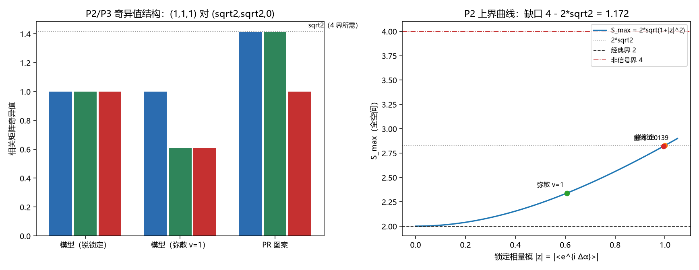

# 注记-齐雷尔森上界来源的最小验证：单位相量结构与奇异性缺口（为何止步 2√2）

- **日期**：2026-09-23 13:53:38
- **脚本**：`验证脚本/minimal_verification_tsirelson_bound_origin.py`（种子 20260914，全确定性）
- **图**：见 §五 图 1（`images/minimal_verification_tsirelson_bound_origin.png`）
- **定位**：战线二（P1-29）方向三（上界来源）。v0 与路径甲把 $2\sqrt2$ 在模型内落地为判据级事实（存在性、上界、迁移轮同数），本轮回答"为何是 $2\sqrt2$ 而不是 4"：锁定对的相关结构由单位相量 $\langle e^{i\Delta\alpha}\rangle$ 生成，相关矩阵的奇异值恰为该相量的模（$\le 1$），Horodecki 形式给出全空间上界 $S_{\max} = 2\sqrt{1+\vert z\vert^2} \le 2\sqrt2$。原理级支持（信息因果性）见 [[研究方向-方向三：为何止步 2√2（信息因果性路线）推导稿]]。
- **关联**：[[贝尔违反的场侧闸门：纠缠锁定对、经典圈对照与可见度阈]]（v0 命题 2、3、J10 与象限对齐）、[[注记-二-2 路径甲迁移轮的最小验证：由快照相位分布到 CHSH 的体系内计算]]（迁移轮与增强轮 J5 的同数核对）、[[锁定帧与格距无关性：先验纠缠的定量形式化]]（命题 24 的接口）、[[研究方向-方向三：为何止步 2√2（信息因果性路线）推导稿]]（路线一与路线三）、[[开放问题总览：元相子理论待解决问题清单]]（P1-29）

---

## 一、判据（运行前写死）

| 序 | 判据 | 验收数值 |
|---|---|---|
| P1 | 相量结构：锐 $\Delta\alpha$ 给 $B^2 = I$ 与 $\vert z\vert = 1$；wrapped 族给 $(c, s) = (e^{-v/2}, 0)$ | 1e-15；$5\sigma$ |
| P2 | 上界：三奇异值 $(1, \vert z\vert, \vert z\vert)$；Horodecki $S_{\max} = 2\sqrt{1+\vert z\vert^2}$；锐锁定给 $2\sqrt2$ | 1e-15；1e-12 |
| P3 | 4 界不可达：PR 块奇异值 $(\sqrt2, \sqrt2)$ 给 $S = 4$；该图案对应 $(c, s) = (1, 1)$（模 $\sqrt2$）；模型族 $\vert z\vert \le 1$ | 1e-12；$5\sigma$ |
| P4 | 象限对齐与弥散损失：锐 $\Delta\alpha$ 的子午面最大 $2\sqrt{1+\cos^2\Delta\alpha}$ 小于全空间 $2\sqrt2$；wrapped 族两口径合流为 $2\sqrt{1+V^2}$ | 1e-6 |
| P5 | 体系窗口接口：窗内 $\vert z\vert$ 给 $S_{\max}$（与路径甲 J5 表一致） | 1e-12 |

## 二、模型设定

每侧两条通道：层位 $Z$（锁定，层位对层位相关 $=1$）与表针象限 $(X, Y)$（一个复数的实虚部）。象限相关块由相量生成：

$$B = \begin{pmatrix} c & s \\ s & -c \end{pmatrix}, \qquad c = \langle\cos\Delta\alpha\rangle,\quad s = \langle\sin\Delta\alpha\rangle,\quad z = \langle e^{i\Delta\alpha}\rangle = c + i s .$$

相关矩阵 $T = \mathrm{diag}(1, B)$（层位与指针的交叉相关为零），三个奇异值即 $(1, \vert z\vert, \vert z\vert)$。锐锁定（$\Delta\alpha$ 取确定值）给 $\vert z\vert = 1$ 且 $B$ 是反射（$B^2 = I$）；弥散（同心 wrapped 族，方差 $v$）给 $\vert z\vert = e^{-v/2} < 1$。Horodecki 形式给出全空间 CHSH 最大 $S_{\max} = 2\sqrt{s_1^2 + s_2^2}$，代入三奇异值得

$$S_{\max} = 2\sqrt{1 + \vert z\vert^2} \le 2\sqrt2 .$$

4 界需要两个奇异值取 $\sqrt2$，即相关块为 $\begin{pmatrix} 1 & 1 \\ 1 & -1 \end{pmatrix}$（"全对/全错"的 PR 图案，对应 $(c, s) = (1, 1)$）。该点的相量模为 $\sqrt2$，超出单位相量的上限 1，故单相位锁给不出。

## 三、结果（实测 vs 期望）

| 判据 | 实测 | 期望 | 判定 |
|---|---|---|---|
| P1 锐锁定 $B^2$ 对 $I$ | $2.6\times10^{-17}$ | $\le 10^{-15}$（5 档 $\Delta\alpha$） | 过 |
| P1 锐锁定 $\vert z\vert$ | $0.0$（偏差） | $1$ | 过 |
| P1 wrapped 族 $(c, s)$ | $0.54\sigma$ | $5\sigma$（$2\times10^6$ 发/档，3 档 $v$） | 过 |
| P2 三奇异值 | $0.0$（偏差） | $(1, \vert z\vert, \vert z\vert)$ | 过 |
| P2 Horodecki 偏差 | $4.4\times10^{-16}$ | $10^{-12}$ | 过 |
| P2 锐锁定 $S_{\max}$ | $2.828427124746$ | $2\sqrt2$（差 $0.0$） | 过 |
| P3 PR 块奇异值 | $1.414214, 1.414214$ | $\sqrt2, \sqrt2$ | 过 |
| P3 PR 图案 $S$ | $4.000000000$ | 恰 4 | 过 |
| P3 模型族 $\vert z\vert$ 超限 | $0.0$ | 无样本超出 $1 + 5/\sqrt N$（200 组随机分布） | 过 |
| P4 锐 $\Delta\alpha$ 子午面对闭式 | $4.4\times10^{-16}$ | $10^{-6}$（4 档） | 过 |
| P4 $\Delta\alpha = 1.2$ 两口径 | 子午面 $2.127255$ 对全空间 $2.828427$（损失 $0.701$） | 全空间 $= 2\sqrt2$；子午面严格更小 | 过 |
| P4 wrapped 族两口径合流 | $4.4\times10^{-16}$ | $10^{-6}$（3 档 $v$） | 过 |
| P5 窗内接口 | $\vert z\vert = 0.993836$ 给 $S_{\max} = 2.819724$ | 路径甲 J5 记录 $2.819724$（差 $3.9\times10^{-6}$） | 过 |

汇总 $5/5$ 通过。三个读数连成一句话：锐锁定把相关块钉在单位圆上（$B^2 = I$，三奇异值全 1），上界恰为 $2\sqrt2$；4 界的图案落在单位圆外（相量模 $\sqrt2$）。

弥散（$\vert z\vert < 1$）把上界按 $2\sqrt{1+\vert z\vert^2}$ 往下拉；联合条件窗内 $\vert z\vert = 0.9938$，上界只降 $0.31\%$。

## 四、过程记录（一处口径订正）

P3 的初版把 4 界的图案写成"奇异值 $(2, 0)$"，运行即判负（实测 $(1.414214, 1.414214)$）。订正为 $(c, s) = (1, 1)$ 的超单位圆读法后判据通过。教训：4 界的 PR 图案在同一套相量语言里表现为"相关块的相量模为 $\sqrt2$"，而奇异值 $\sqrt2$ 只是同一件事的等价说法；把 4 界读成"某个零奇异值"是错的。

## 五、图

图 1 两联。左为 P2/P3 的奇异值结构对照：模型（锐锁定）$(1, 1, 1)$、模型（弥散 $v=1$）$(1, 0.6065, 0.6065)$、PR 图案 $(\sqrt2, \sqrt2, 0)$，参考线为 $\sqrt2$（4 界所需）。右为 P2 的上界曲线 $S_{\max} = 2\sqrt{1+\vert z\vert^2}$，三条水平线分别是经典界 $2$、$2\sqrt2$ 与非信号界 $4$，三个标注点为锐锁定、弥散 $v=1$ 与联合条件窗内 $0.9938$，缺口 $4 - 2\sqrt2 = 1.171573$。

## 六、边界声明

**验证什么**：模型内上界的结构来源。相关块的相量生成、奇异值 $\le 1$、Horodecki 形式与 $2\sqrt2$ 的等价，以及 4 界所需图案落在单位圆外的定量对照。

**不验证什么**：不声称公理级结论（"为何物理世界选 $2\sqrt2$"的原理级支持见方向三推导稿的路线一，属引用级）；Y 象限不作相位语言合成（本轮用相关矩阵结构处理全空间口径）；信息因果性的模型内定量判据未执行，登记为开放项；不改动任何基准文档。

## 七、结论

上界的模型内来源落实为一处结构事实：锁定的相位余量 $z = \langle e^{i\Delta\alpha}\rangle$ 是单位相量（$\vert z\vert \le 1$，锐锁定取等号），相关块随之是反射（$B^2 = I$），三奇异值 $(1, \vert z\vert, \vert z\vert)$ 经 Horodecki 形式给出 $S_{\max} = 2\sqrt{1+\vert z\vert^2} \le 2\sqrt2$。4 界要求的 $(\sqrt2, \sqrt2)$ 图案落在单位圆外。

两个口径的差别：锐失配只旋转象限（子午面损失 $2\sqrt{1+\cos^2\Delta\alpha}$ 对全空间的差），弥散才降上界，两条口径在对称 wrapped 族上合流为 $2\sqrt{1+V^2}$。
