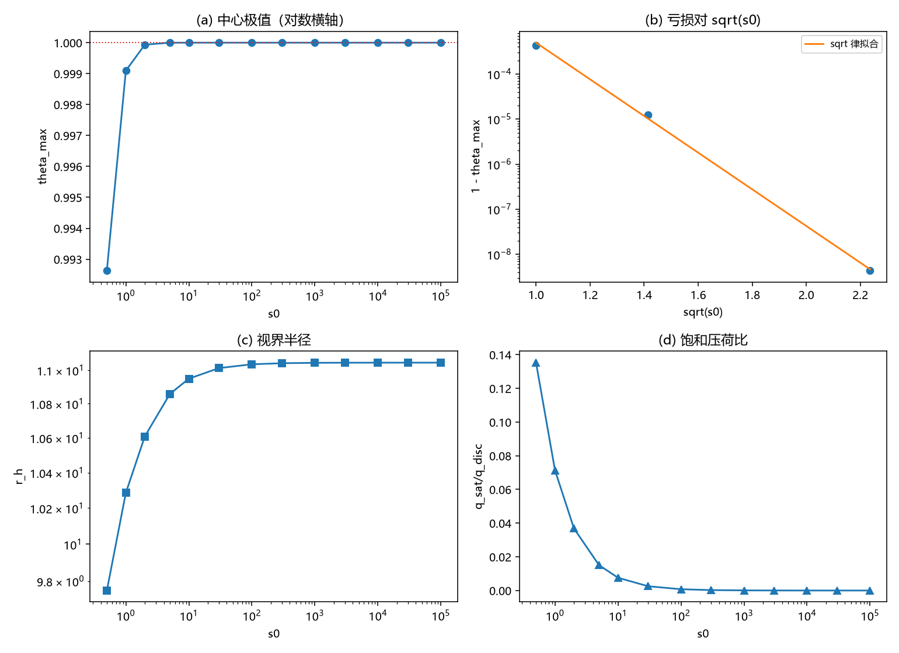
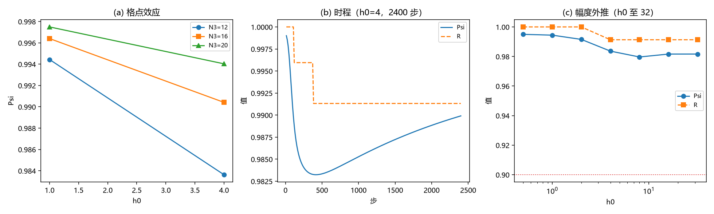
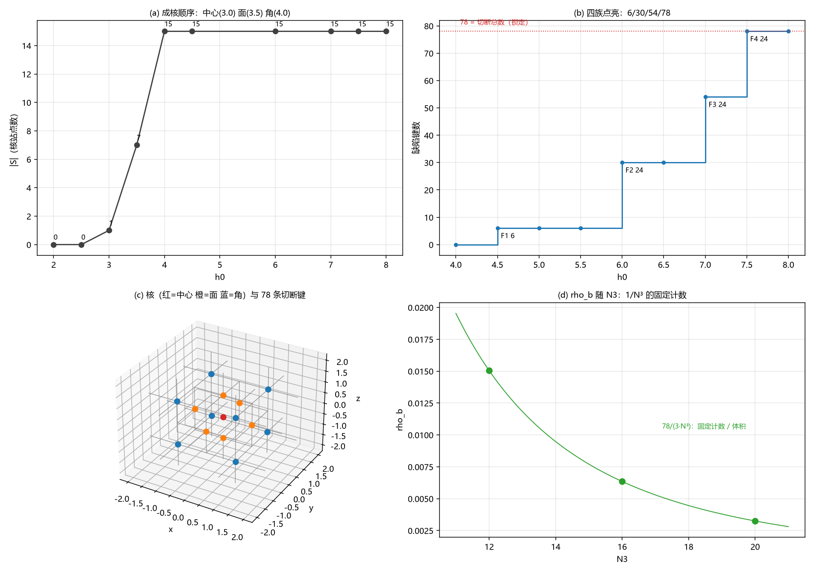
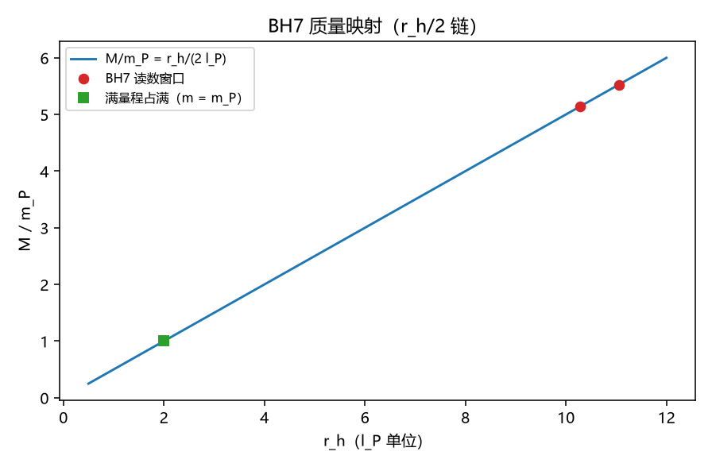

# 黑洞奇点与晶格损坏：饱和封顶、满偏渐近与结构序稳健性

- **作者**：傅天行（天行新学研究院）
- **预印本**：傅天行. (2026). 黑洞奇点与晶格损坏：饱和封顶、满偏渐近与结构序稳健性. 天行新学研究院预印本.
- **日期**：2026-09-20
- **状态**：已转正（作者指示 2026-09-20：评审、修复与转正一次性执行；七维评审无 A 级，B 级 6 项、C 级 6 项已修订）
- **关键词**：元相子；黑洞奇点；晶格损坏；满偏封顶；饱和源模型；交错序参量；缺陷密度；质量刻度
- **修订记录**：
  - **2026-09-20 首次落盘**（触发：作者指示直接起草第二主问题成篇论文）
    - 素材为第二主问题判据草案（W 系列）与八份执行材料（W1、W1 开域、W2、W4、W3、C1 接口、ρb 机制归属、耦合强度与质量映射）；判决表与开放问题按各材料原登记口径转写
  - **2026-09-20 七维评审修订**（依据：[[评审报告/评审报告-黑洞奇点与晶格损坏-2026-09-20]]；无 A 级，B 级 6 项、C 级 6 项）
    - B1 映射标定窗口补声明；B2 满偏不可达补扫描域限定；B3 正部算子补定义；B4 观测端补读数与引用；B5 耦合臂跨度补口径；B6 $\Psi$ 符号同名补区分
    - C1 裁决十七补引用；C2 措辞修正；C3 舍入关系注明；C4 映射链补中间式；C5 专名补释义；C6 BH3-5 链补出处；参考文献补 [28]
  - **2026-09-20 转正**（作者指示：评审、修复与转正一次性执行）
    - 状态改为已转正；子理论索引第三节与状态跟踪区同步；黑洞线计划修订记录回填
  - **2026-09-21 复查批次回填**（触发：H3 轮执行）
    - 开域表「机制失义越界」行更新：$\lambda/J > 1$ 已扫（延拓至 $\lambda = 50$：源区无阈值、非源区属机制失义）
  - **2026-09-27 位移完成条件机制层补注**（触发：判据 DC1 至 DC3，第 446 条；作者确认 90° 视界与 180° 满偏两层最合理）
    - 视界条件段补两层机制：视界 90° 运动学停滞、满偏 180° 结构崩溃（位移取消、承载退出）
  - **2026-10-24 封顶口径注**（触发：作者 2026-10-24 裁决「饱和因子多余」，恒真检验交付）
    - §3.1 补口径注：满偏不可达属模型层，其不可达性由 $g(1)=0$ 保证而非动力学导出；去掉因子时中心值随源强线性增长（$s_0=1$ 给 $18$），换其他归零因子时逼近斜率从 $-0.8$ 跨到 $-12$
    - 本节数值与判据结论未改；本文自述的「结论属模型层」立场不变，本次补的是模型层内部的可导出与不可导出之分
    - 论证与同步清单见 [[冲突诊断/注记-饱和因子是否有必要：封顶的恒真检验与模型地位（2026-10-24）|饱和因子注记]]

---

## 摘要

元相子理论把引力读作质量驱动下的记录场写入，由此给出黑洞线的两个主攻问题。第一个问题（视界的形成与相对论光锥机制的兼容）已由专文收束，本文处理第二个：黑洞奇点与普朗克尺度下的晶格损坏是否真实存在。

「损坏」被落成三档操作定义：结构序破坏，即相邻反相的交错结构与碰撞接力失效；机制失义越界，即记录角越过满偏 $\theta > 1$；饱和封顶，即饱和源把中心封在满偏之下。六组材料按先立判据、后出读数的纪律执行，本文只作合成与转写。

封顶一侧的读数：登记口径下中心极值 $\theta_{\max} = 0.9991$；亏损按 $e^{-9.4\sqrt{s_0}}$ 指数衰减，$\theta_{\max} \le 1$ 至 $s_0 = 10^5$ 全程不越界；有效荷封顶 $\sim 69$，视界半径自 $10.29$ 仅升至 $11.05\,l_P$。

结构序一侧的读数：交错序参量在写入幅度至 $h_0 = 32$ 时无破坏阈值（$\Psi \ge 0.9797$），退化随格点放大而变小，2400 步无延迟塌缩；键级缺陷密度在 $h_0 \le 4$ 恒为零，$h_0 \ge 8$ 的锁定读数 $0.01505$ 为一个固定 15 站反相核的切断计数。

判决：在登记口径与全部扫描域内，晶格未显示损坏读数。损坏的触发需要登记形式之外的驱动与语义之外的判据；剩余两条通道归口粒子线（$m_\delta$）与远期同根判据（U3）。本文理论位置：承接记录场路线与第一主问题专文，属模型层判决，不引入新公设。

## 一、引言

### 1.1 问题的提出

元相子理论的黑洞线近期在形成与终态两端落定判别：形成段的「写入-补位竞赛」图像被零阶执行否定后，任务序列改为支撑失效判据；终态段收缩为饱和源模型与摆程层协议[20]。在这一基础上，作者提出两个更根本的检验问题：其一，视界的形成要与相对论的光锥机制兼容；其二，黑洞奇点与普朗克尺度下的晶格损坏是否真实存在。第一个问题已由专文处理[1]，本文处理第二个。

第二主问题的链条登记在物质汇聚方案中：引力由质量驱动写入，质量越大写入越快，记录场向满偏逼近；到 $m = m_P$ 时满量程占满，格点面临撑不住的问题[21]。这条链含三处须先澄清的语义：破坏区由本原吸收接管，属物侧之外的步骤；破坏不等同于落回元相海；接力失效之后漏洞扩大，可能摧毁时空[21]。

链条要成为可判决的问题，「损坏」必须操作化。本文沿用判据草案的三档定义[8]，每档配独立读数，并在各自的扫描域内给出闭域或开域登记；首轮执行的总判断见小结材料[19]。

### 1.2 本文在体系中的位置

本文从元相子晶格与记录场机制出发，承接量子引力记录场路线的识别式与单位链（$h_{00} = 2\theta$、$G/(c^2 l_P) = 1/m_P$）[2]，承接第一主问题专文的强场剖面与完成判决[1]，承接饱和源模型[3]、满偏角极限判据 J1 至 J5[4]与强场动力学两轮读数[5][6]。

本文不重复推导上述内容，直接引用其结论。本文补充的部分为六组读数：满偏可达性总表与封顶曲线[9][13]、交错序参量的结构序读数[10][11]、缺陷密度接口与机制归属[14][15]、越界构型的探索与语义判定[12]、耦合符号与强度换算[7][16]、质量刻度映射[17]。

本文结论属模型层：饱和源模型为径向静态，摆程层协议为格点动力学，两者的参数（$s_0$、$h_0$）到物理质量的映射经 $r_h$ 单值中转[17]。本文不修改理论总纲基准，不引入新公设。

### 1.3 结构预告

第二节给模型与判据体系：记录场、饱和源模型、摆程层协议与损坏三档定义。第三节给六组核心读数。第四节给三档判决总表、第二主问题当前读数、与统一奇点截断及第一主问题的接口。第五节为严格程度声明、局限与开放问题。第六节结论。

## 二、模型与判据体系

### 2.1 记录场与饱和源模型

记录场读数为法线角 $\theta$，其径向静态方程为

$$
\nabla^2\theta = -s_0\,(1-\theta^2)_+,
$$

源区 $r \le R_S = 6$（格点单位 $l_P = 1$），外边界取自洽 Robin 条件，自适应扩域保证 $r_{\text{out}} \ge 10\,r_h$[3][13]。方程右侧的饱和因子 $(1-\theta^2)_+$ 使源强在中心附近被记录自身取值截断，这是「饱和源」名称的来源。记号 $(x)_+ = \max(x, 0)$ 为正部算子；越满偏区（$\theta > 1$）源项为零，方程退化为无源支。

远场识别式为 $\theta(r) = r_s/(2r)$，视界条件 $\theta = 1/2$ 给 $r_h = r_s$；单位链恒等式 $G/(c^2 l_P) = 1/m_P$ 在定义式下机器级成立[2][17]。2026-09-27 补位移完成条件的机制层：视界（$\theta = 1/2$，$90^\circ$ 几何角）为运动学停滞（法线轴位移分量归零、外部信息止步），满偏（$\theta = 1$）为结构崩溃（取向反转、位移取消、承载退出），两层判据 DC1 至 DC3（验证脚本/README.md 第 446 条）。

### 2.2 摆程层协议

格点动力学用 BH3-3 摆程层协议（格点级相位摆动的驱动-弛豫协议）[3]：$12^3$ 格点（对照档 $16^3$、$20^3$）、交错基态 $\mathrm{base} = \pi(i+j+k)$、半径 2 的种子滴与滴表面写入位、过阻尼弛豫与节拍驱动（$T_{\text{beat}} = 12$、$dt = 0.02$、600 步恰一拍）、固定噪声种子。

演化式为 $\theta \leftarrow \theta - dt\,(-g + \lambda \sin\theta\,h) + \mathrm{drive}$，其中 $g$ 为六近邻正弦耦合和。耦合符号按裁决二十六取登记值（回拉），强度按惯例 $\lambda/J = 1$[7]；实际值的换算见 §3.5。

### 2.3 损坏的三档操作定义

其一，结构序破坏：交错结构失效，即接力断裂与缺陷不可逆增殖。直接读数为交错序参量 $\Psi$、接力连续性 $R$ 与键级缺陷密度 $\rho_b$：$\Psi = \vert\overline{e^{id}}\vert$（$d = \mathrm{wrap}(\theta - \mathrm{base})$），$R = \overline{[\vert d\vert < \pi/2]}$，$\rho_b$ 为相位差偏离 $\pi$ 超过 $\pi/2$ 的键占比[10][14]。符号说明：$\Psi$ 为交错序参量的局部符号，与术语表中相干耦合态同名、含义不同。

其二，机制失义越界：$\theta$ 越过 $1$。J1 至 J5 已把满偏判为有效域边界：取向完全反向、映射无饱和、取值空间非紧致相容，双覆盖锚落在 SO(3) 二阶元与 SU(2) 四阶元[4]。边界之外构型的物理地位未定。

其三，饱和封顶：饱和源把中心封在 $1$ 以下（D3 读数 $0.9991$[3]），动力学是否真越界由 W4 判定[13]。层界说明：本原吸收为物侧之外步骤[21]，不入本文判据。

## 三、核心读数

### 3.1 满偏的可达性与封顶曲线

W2 总表[9]合成既有读数：登记口径下中心极值为 $\theta_{\max} = 0.9991$；越界路径仅在对照臂（负耦合能量）出现，阈值 $\lambda^* \approx 6$ 至 $7\times10^{-4}$；大振幅驻态族 $h$ 至 $10$ 存在且稳定[22]，超满偏两候选均否[23]，越门后的落点分类存在且有界[24]。

W4[13]把单点细化成曲线：源强 $s_0$ 扫过七个数量级（$0.5$ 至 $10^5$），含分辨率研究（$dr = 1, 0.5, 0.25$ 三点 Richardson 外推，$p = 2$）。亏损 $1-\theta_{\max}$ 的连续极限外推为 $4.35\times10^{-4}$（$s_0 = 1$）与 $4.36\times10^{-9}$（$s_0 = 5$）；$\ln$ 亏损对 $\sqrt{s_0}$ 的斜率为 $-9.37$（残差 $0.20$），即中心按 $e^{-9.4\sqrt{s_0}}$ 逼近满偏。

判据量结论：在模型与扫描域内（$s_0 \le 10^5$）精确满偏不可达（亏损按 $e^{-9.4\sqrt{s_0}}$ 恒正、单调趋零）；接近极快（亏损 $\le 10^{-6}$ 只需 $s_0 \approx 2.8$）。连带读数为两条封顶：有效荷封顶 $\sim 69$，视界半径自 $10.29$ 仅升至 $11.05\,l_P$；饱和压荷比由 $0.0714$ 跌至 $10^{-5}$ 量级。源强增加几乎全部被饱和遮蔽，外围几何响应被截断，中心读数继续逼近满偏。

**口径注（2026-10-24 作者裁决后补）**。「精确满偏不可达」及 $e^{-9.4\sqrt{s_0}}$、$s_0\approx2.8$ 等读数属**模型层**。其不可达性由饱和因子的零点位置保证：$g(1)=0$ 时 $\theta\equiv1$ 是方程的解，故 $\theta_{\max}\le1$ 与源强无关。

同一方程去掉该因子（$g=1$）时中心值随源强线性增长，$s_0=1$ 即给 $18$，越界无阻力；换成其他在 $\theta=1$ 归零的因子，封顶仍在但逼近斜率从 $-0.8$ 到 $-12$ 跨一个量级以上。

故本节读数读作「该模型在此设定下的行为」，不读作「理论预言满偏不可达」；后者需要 $g(\theta)$ 的微观导出，目前没有。论证与同步清单见 [[冲突诊断/注记-饱和因子是否有必要：封顶的恒真检验与模型地位（2026-10-24）|饱和因子注记]]。本节数值与判据结论未改。

过程级教训一条：首版直接拟合 $dr = 1$ 读数得斜率 $-5.09$、残差 $0.60$，分辨率伪影主导；边界层厚度 $1/\sqrt{2s_0}$ 须先于拟合检查网格分辨[13]。

### 3.2 结构序的稳健性

W1[10]以交错序参量读结构序：无写入锚 $\Psi = 0.995054$（$\lambda = 0$ 与 $1$ 差为零），退化量 $\Delta\Psi$ 为 $7.7\times10^{-5}$（$h_0 = 0.5$）与 $1.14\times10^{-2}$（$h_0 = 4$）；接力连续性至 $h_0 = 2$ 保持 $R = 1.0000$，$h_0 = 4$ 时 $0.9913$。轨迹单调缓降，无翻转或丢失窗口。

W1 开域[11]沿三轴外推：格点放大使退化变小（$\Psi(h_0 = 4)$ 由 $0.983629$ 至 $0.994031$，于 $N_3 = 12/16/20$）；时程 2400 步无延迟塌缩（$R$ 恒 $0.99132$）；幅度至 $h_0 = 32$ 无 $\Psi < 0.9$ 档（$\Psi \ge 0.9797$）。三档读数同向：无阈值、有限尺寸效应为负、时程稳定。

### 3.3 缺陷密度接口与机制归属

C1 接口[14]立两线共用读数（反相键与缺陷位点），并给出定义分离：位点级漂移 $0.87\%$ 为集体性，键级缺陷在 $h_0 \le 4$ 恒为零，位点相干与键密度不可互推（分离量 $8.7\times10^{-3}$）。

开域轮报出 $\rho_b$ 于 $h_0 \ge 8$ 定量锁定 $0.01505$（即 $78/5184 = 0.015046$ 的五位舍入）[11]。ρb 机制归属轮[15]把该读数定位到格点级几何对象：由 $\pi$ 整数场 $m = \mathrm{rint}(\theta/\pi) - (i+j+k)$ 读出翻转核 $S$ = 滴心并滴内奇子格（6 面邻加 8 角，共 15 站）；缺陷键集合逐键等于核的切断 $\mathrm{cut}(S)$，共 78 条。

锁定读数的正确形式为固定计数除以体积：$\rho_b = 78/(3N_3^3)$，$N_3 = 12/16/20$ 给 $0.015046$、$0.006348$、$0.003250$；核与 $h_0$、随机种子、格点大小无关（逐点相同）。滴表面壳层假说被排除：缺陷键与滴边界键之交仅 24 条，其余 54 条位于滴内部。

成核顺序为滴心（$h_0 \approx 3.0$）、加 6 面邻（3.5）、加 8 角（4.0）；切断四族依次于 $4.5$、$6.0$、$7.0$、$7.5$ 点亮，累计 6、30、54、78。$\lambda = 0$ 对照无核无缺陷。

### 3.4 越界探索与语义判定

W3[12]在对照臂（负耦合能量，登记形式之外）上找到越界解枝：$\lambda_0 = 0.01$ 起中心越过 $1$，至 $\lambda = 1$ 达 $\theta_{\max} = 3.119$（接近整圈），越偏核半径由 $3.15$ 扩至 $15.35$ 格；全部构型为光滑收敛解（残余 $\le 10^{-13}$）。登记符号下无越界路径。

二择一判定取机制失义：越界枝的驱动项在裁决二十六登记形式之外；J1 至 J5 已立满偏为有效域边界，边界之外不构成新物理区[4][12]。

稳定性判据经修正判定为退化：饱和源模型在 $\theta \ge 0$ 上凸（源项二阶导 $2s_0\theta \ge 0$），任何驻点恒线性稳定，稳定性不构成区分性判据；凸性核验与谱读数双证通过（全域最小本征值 $2.791\times10^{-5}$ 即慢模 $(\pi/L)^2$）[12]。

### 3.5 耦合符号与强度换算

裁决二十六把耦合符号登记为回拉、强度惯例登记为 $\lambda/J = 1$[7]。两臂对照读数：登记臂至 $\lambda = 1$ 全程存在，中心由 $0.999$ 降至 $0.63$ 至 $0.91$（三档边界口径的终点跨度），视界收缩至 $5.34$ 至 $6.56$；对照臂在 $\lambda^* \approx 6$ 至 $7\times10^{-4}$ 越满偏[5]。

瞬态层读数[6]：外围库仑形全程维持（散布 $\le 0.82\%$、$D_{\text{vac}} \le 0.0077$），弛豫为分层慢扩散（尾时标 $r^2/D$），耦合臂瞬态不放大（$1.01$）。

强度换算[16]：登记恒等式与本构比字典合取给

$$
\lambda/J = (m_\delta/m_P)^2 = 6\pi\,\kappa_\phi t_P.
$$

门槛表：$\lambda^* \leftrightarrow m_\delta = 0.0255\,m_P$、$\lambda_0 \leftrightarrow 0.1\,m_P$、惯例 $\leftrightarrow m_P$；$\lambda$ 为格点常数，各质量档共用。剩余单点 $m_\delta$ 属粒子线。

### 3.6 质量刻度映射

质量映射[17]把读数接到物理刻度：由 N5 恒等式与远场识别式（$r_s = 2(l_P/m_P)M$、$\theta(r_h) = 1/2$）得

$$
M/m_P = r_h/(2\,l_P).
$$

BH7 读数窗口对应 $M = 5.14$ 至 $5.52\,m_P$（$r_h$ 由 $10.285$ 至 $11.05\,l_P$）；BH3-5 链的「$m = m_P$ 满量程占满」对应 $r_h = 2\,l_P$、$\theta(l_P) = 1$[21]；压弯角律复核一致（$\alpha = 180^\circ \times M/m_P$）。映射的标定窗口为饱和核（$r_h \approx 10$ 至 $11\,l_P$），满量程点的对应关系为登记链读法，未在饱和核窗口外独立标定[17]。

## 四、推论与讨论

### 4.1 三档判决总表

| 档 | 判据材料 | 判决 | 开域 |
|---|---|---|---|
| 结构序破坏 | W1、W1 开域、C1 接口、ρb 机制归属 | 无破坏阈值；锁定读数为固定核的切断计数 | 更大驱动（对数倍）、多拍累计、核尺度重标 |
| 机制失义越界 | W2、W3、W4、J1 至 J5 | 单侧渐近线；越界枝只在登记形式之外；判定机制失义 | $\lambda/J > 1$ 已扫（2026-09-21，延拓至 $\lambda = 50$：源区无阈值、非源区属机制失义） |
| 饱和封顶 | W2、W4 | 非硬顶；外围几何封顶、中心渐近满偏 | 更轻质量核重标（$M < 5\,m_P$） |

### 4.2 第二主问题的当前读数

「普朗克质量导致晶格损坏」在模型内的读法是渐近占满；越界与缺陷增殖两条通道在登记口径下均未开启：满量程点（$r_h = 2\,l_P$）按登记链读作 $M = m_P$，BH7 扫描窗口（$M \approx 5.1$ 至 $5.5\,m_P$）在其更重一侧，几何封顶与记录渐近两条读数并存[13][17]。

另一条在册通道是耦合触发：S3N 时域读数显示触发次序随斜坡速率翻转，满偏后记录锁定 $3.0664$、能量有界[25]；BH3-4 裁决十八给出「耦合先触发、破坏不必待满偏」[9][26]。该读数与封顶读数属不同对象：前者讲触发时点，后者讲幅度封顶。

### 4.3 与统一奇点截断方向的接口

温度侧定理 U1 已立（复相干无序度有界性截断，$T_P = E_P/k_B$）；几何侧读数由本线六组材料充实；U3（同根判据）要求从 $S^1 \times \mathbb{R}$ 的两轴同时导出 $T_P$ 与 $\theta_{\max} \sim O(1)$，共用普朗克标度入口，属远期项[18]。

### 4.4 与第一主问题的关系

第一主问题收束于「视界作为光锥闭合面」的三层判定；本文给奇点一侧的对偶读数：记录在强场贴住满偏而不穿越（$\theta_{\max} \to 1$、单侧渐近线），外围几何被饱和截断。两篇合起来构成本线对作者两问的回答框架[1][13]。

### 4.5 可计算量与可检验项

其一，亏损律 $1-\theta_{\max} \sim e^{-9.4\sqrt{s_0}}$ 可由独立求解器复核（斜率与残差为登记读数）。其二，格点预言 $\rho_b = 78/(3N_3^3)$ 可加格点复核。其三，门槛表 $\lambda^*(m_\delta)$ 与 $\lambda_0(m_\delta)$ 在粒子线给出 $m_\delta$ 后即定[16]。其四，满量程点 $r_h = 2\,l_P$ 与 $M = m_P$ 的对应是质量刻度上的可复核恒等式[17]。其五，U3 同根判据为远期可检验项[18]。

## 五、讨论

### 5.1 严格程度声明

| 结论 | 严格程度 | 依据或缺口 |
|---|---|---|
| $M/m_P = r_h/(2\,l_P)$ | 条件性命题 | 条件：远场识别式与 N5 单位链在册 |
| $\theta_{\max}$ 单侧渐近、精确满偏不可达 | 模型层读数 | 径向饱和源；$dr$ 外推 $p = 2$ 假设 |
| 结构序无阈值（至 $h_0 = 32$） | 模型层读数 | 摆程层协议；扫描域有限 |
| 锁定读数为固定 15 站核的切断 | 模型层读数（集合级） | 协议与几何给定；微观选择规则未导出 |
| 越界枝判定机制失义 | 条件性命题 | 条件：裁决二十六登记符号与 J1 至 J5 |
| $\lambda/J = (m_\delta/m_P)^2$ | 条件性命题 | 条件：本构比读法与裁决十七字典在册（[16]） |

### 5.2 局限与开放问题

其一，耦合强度实际值压缩为单点 $m_\delta$，属粒子线归口；其值不影响登记符号臂的判决（至 $\lambda = 1$ 无阈值），仅 $\lambda/J > 1$ 需复扫[16]。其二，$s_0$、$h_0$ 到物理质量的换算经 $r_h$ 单值中转，未经独立标定；更轻质量核（$M < 5\,m_P$）与满量程点的直接扫描需按核尺度重标 $R_S$[17]。

其三，U3 同根判据未做[18]。其四，C1 连续形态的同一性（闭合反相核边界到连续畴壁包裹体）属 C1 线[15]。其五，观测端（BH5 差分侧）首期读出形状门残差 $1.7\times10^{-5}$，对 $10^{-2}$ 级门槛裕度约两个数量级，判观测不可及并封存（附重开条件）[28]，不在本文范围。上述各项已按开放问题同步规范登记于开放问题总览[27]。

## 六、结论

本文把作者的第二个主攻问题落成三档操作定义与六组先立判据、后出读数的材料。判决为：在登记口径与全部扫描域内，晶格未显示损坏读数。满偏是单侧渐近线（$\theta_{\max} \le 1$、亏损 $e^{-9.4\sqrt{s_0}}$）；结构序无破坏阈值；缺陷锁定读数为固定 15 站反相核的切断计数（$\rho_b = 78/(3N_3^3)$，按 $N_3^{-3}$ 衰减）；越界枝只在登记形式之外存在并判为机制失义。

损坏的触发需要登记形式之外的驱动与语义之外的判据，剩余归口为 $m_\delta$ 与 U3 两条。理论地位：第一主问题答视界一侧，本文答奇点一侧，两者合成「视界为光锥闭合面、奇点为饱和接管」的强场图像。

## 参考文献

- [1] [[视界的光锥兼容性：闭合面判据、真空完成判决与停滞律收束]]（根目录，第一主问题专文）
- [2] [[量子引力的记录场路线：法线场涌现、绝对标度锁定与史瓦西对齐]]（根目录，N5）
- [3] [[验证脚本/注记-M4-D3视界线自洽性与写入判据：饱和源模型与写-弛豫协议]]（验证脚本，第 89 条）
- [4] [[验证脚本/注记-满偏角的极限地位：机制失义边界、视界过零与双覆盖锚（J1至J5）]]（验证脚本，第 141 条）
- [5] [[验证脚本/注记-U2（最小臂）：耦合重开区的有效应力判决]]（验证脚本，第 217 条）
- [6] [[验证脚本/注记-U2（瞬态层）：写-弛豫轨迹上的真空保持与停滞律轨迹]]（验证脚本，第 218 条）
- [7] [[内部草稿/裁定材料-耦合符号与强度：登记符号（回拉）与强度惯例]]（内部草稿，裁决二十六）
- [8] [[内部草稿/判据草案-第二主问题：普朗克质量与晶格损坏的判别（W系列）]]（内部草稿）
- [9] [[内部草稿/判别准备-BH7-W2：满偏可达性总表与越界路径盘点：2026-09-20]]（内部草稿）
- [10] [[验证脚本/注记-BH7-W1：交错序参量读数（结构序破坏的微观判据：无阈值的平滑退化）]]（验证脚本，第 222 条）
- [11] [[验证脚本/注记-BH7-W1 开域：三轴外推（格点效应、时程稳定性与缺陷密度饱和）]]（验证脚本，第 228 条）
- [12] [[验证脚本/注记-BH7-W3：越界构型的探索读数（存在性与结构；稳定性口径未立）]]（验证脚本，第 225 条）
- [13] [[验证脚本/注记-BH7-W4：封顶曲线（满偏逼近的连续极限与有效荷封顶）]]（验证脚本，第 220 条）
- [14] [[内部草稿/接口材料-BH7xC1：缺陷密度读数（反相键与缺陷位点代理）与最小实现]] 与 [[验证脚本/注记-BH7xC1 接口：缺陷密度代理读数（键级零缺陷与位点漂移的分离）]]（内部草稿与验证脚本，第 226 条）
- [15] [[验证脚本/注记-BH7-ρb 机制归属：反相核与切断读数（缺陷键集的几何定位与机制判定）]]（验证脚本，第 258 条）
- [16] [[验证脚本/注记-耦合强度实际值：lambda = (m_delta-m_P)^2 换算链与 BH7 门槛表]]（验证脚本，第 231 条）
- [17] [[验证脚本/注记-质量映射：BH7 读数到 M-m_P 的换算（r_h-2 链与单位链复核）]]（验证脚本，第 227 条）
- [18] [[内部草稿/研究方向-统一奇点截断原理：温度截断与几何饱和的合流]]（内部草稿，U1 至 U4）
- [19] [[内部草稿/总结报告-BH7首轮小结：第二主问题四件读数与判据退化教训：2026-09-20]]（内部草稿）
- [20] [[理论攻坚/黑洞线攻坚计划：坍缩机制重定位与强场终态]]（理论攻坚）
- [21] [[内部草稿/注记-黑洞内部机制的候选方案：物质汇聚、晶格破坏与本原吸收]]（内部草稿，BH3-5 链）
- [22] [[验证脚本/注记-BH6 可选后续二轮（严格驻态族）：h 至 10 的驻态连续化、稳定性与剖面口径重算]]（验证脚本，第 188 条）
- [23] [[验证脚本/注记-BH6 可选后续（滑移与超满偏）：稳定性图谱与触发通道判定]]（验证脚本，第 185 条）
- [24] [[验证脚本/注记-BH6 后续三轮（大种子扫掠）：势垒门的幅度定位与落点分类]]（验证脚本，第 193 条）
- [25] [[验证脚本/注记-M6-S3N（非线性在场一读）：斜坡驱动的交错失稳与线性时钟定性对照]]（验证脚本，第 133 条）
- [26] [[内部草稿/判别准备-BH3-4：二候选判别点、证据回流与裁决建议：2026-09-17]]（内部草稿，裁决十八）
- [27] [[内部草稿/开放问题总览：元相子理论待解决问题清单]]（内部草稿）
- [28] [[内部草稿/注记-BH5首期执行：一致组零偏差条目、差分侧量级门与接口登记]]（内部草稿，BH5 首期）
